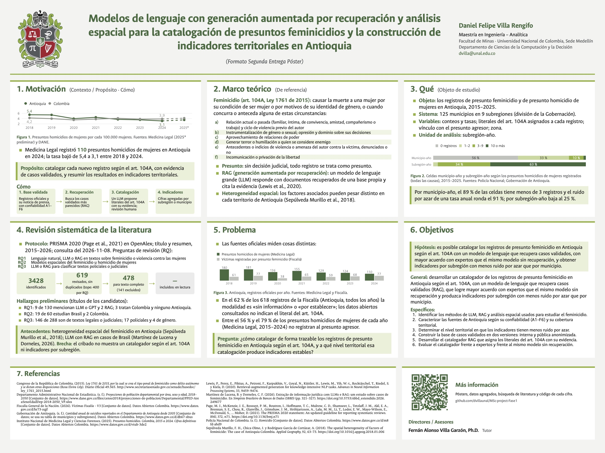

# Presunto feminicidio en Antioquia: modelos de lenguaje con recuperación y análisis espacial

**Modelos de lenguaje con generación aumentada por recuperación y análisis espacial para la catalogación de presuntos feminicidios y la construcción de indicadores territoriales en Antioquia**

Trabajo de grado de la Maestría en Ingeniería – Analítica, Facultad de Minas, Universidad Nacional de Colombia, Sede Medellín.

- **Estudiante:** Daniel Felipe Villa Rengifo
- **Tutor:** Fernán Alonso Villa Garzón, Ph.D. (Departamento de Ciencias de la Computación y la Decisión)
- **Estado (noviembre de 2026):** segunda entrega del póster. La tercera entrega está en borrador. El repositorio crece con cada entrega.

[](04_Entregables/Poster_Entrega2/Poster_Entrega2.pdf)

| Entrega | Póster (PDF, 120 × 90 cm) | Secciones |
| :-- | :-- | :-- |
| Segunda | [`Poster_Entrega2.pdf`](04_Entregables/Poster_Entrega2/Poster_Entrega2.pdf) | Motivación y cómo, marco teórico, objeto de estudio, revisión sistemática, problema, objetivos |
| Tercera (borrador) | [`Poster_Entrega3.pdf`](04_Entregables/Poster_Entrega3/Poster_Entrega3.pdf) | Las anteriores, más el diseño metodológico |
| Primera | [`Poster_Fase1.pdf`](04_Entregables/Poster_Fase1/Poster_Fase1.pdf) | Versión anterior, con el título de la primera fase |

## Pregunta, hipótesis y objetivo

**Pregunta.** ¿Cómo catalogar de forma trazable los registros de presunto feminicidio en Antioquia según el artículo 104A del Código Penal (Ley 1761 de 2015), y a qué nivel territorial esa catalogación produce indicadores estables?

**Hipótesis.** Es posible catalogar los registros de presunto feminicidio en Antioquia según el art. 104A con un modelo de lenguaje que recupera casos validados, con mayor acuerdo con expertos que el mismo modelo sin recuperación, y obtener indicadores por subregión con menos ruido por azar que por municipio.

**Objetivo general.** Desarrollar un catalogador de los registros de presunto feminicidio en Antioquia según el art. 104A, con un modelo de lenguaje que recupera casos validados (RAG), que logre mayor acuerdo con expertos que el mismo modelo sin recuperación y produzca indicadores por subregión con menos ruido por azar que por municipio.

El enfoque es explicativo: no se predicen hechos futuros. El catalogador no decide si hubo un feminicidio; propone qué circunstancias de la ley podrían aplicar a un registro presunto, muestra su evidencia y una persona lo revisa.

## Cómo se trabaja con los datos

- **Siempre «presunto».** Mientras no haya decisión judicial, todo registro se trata como presunto.
- **Cifras, no casos.** Solo se publican cifras agregadas por año, subregión o municipio. No hay relatos, nombres ni textos individuales.
- **Dos versiones de la base.** Una interna, con la fuente y el texto de cada registro, que no se publica. Una pública, agregada, en la que los conteos de 1 y 2 por municipio aparecen como «<3».
- **Cada fuente lleva un código de confiabilidad** (ver [Clasificación de las fuentes](#clasificación-de-las-fuentes)).

## Avances de la segunda entrega

### 1. Revisión sistemática reproducible

[`scripts/rsl_openalex.py`](scripts/rsl_openalex.py) consulta la API abierta de OpenAlex con tres cadenas de búsqueda (protocolo PRISMA 2020) y deja los conteos y la lista de candidatos en [`03_Fuentes_y_Datos/datos/rsl/`](03_Fuentes_y_Datos/datos/rsl/).

| Pregunta de revisión | Tema |
| :-- | :-- |
| RQ1 | Lenguaje natural, LLM o RAG en textos sobre feminicidio y violencia contra las mujeres |
| RQ2 | Modelos espaciales del feminicidio u homicidio de mujeres |
| RQ3 | LLM o RAG para clasificar textos policiales o judiciales |

Ejecución del 8 de noviembre de 2026: 3428 registros identificados, 619 revisados por título y resumen sin duplicados (se descargan a lo sumo 400 por cadena; los duplicados se quitan por id, DOI y título), 141 excluidos y 478 candidatos para leer a texto completo. La inclusión final está en curso. El cribado automático deja falsos positivos; los conteos no son todavía estudios incluidos.

### 2. ¿Municipio o subregión?

[`scripts/viabilidad_nivel_territorial.py`](scripts/viabilidad_nivel_territorial.py) cuenta los homicidios de mujeres por municipio y año (Policía Nacional, 2015–2025) y los agrupa en las 9 subregiones oficiales de la Gobernación de Antioquia.

| Nivel | Celdas | % en cero | % con menos de 3 | Ruido por azar de una tasa (1/√media) |
| :-- | --: | --: | --: | --: |
| Municipio–año | 1.375 | 55,6 % | 88,9 % | 91 % |
| Subregión–año | 99 | 0 % | 3,0 % | 24,5 % |
| Municipio, 11 años sumados | 125 | 8,0 % | 24,8 % | 27,6 % |

Con tan pocos casos por municipio, una tasa municipal anual cambia mucho solo por azar. La unidad de análisis propuesta es la **subregión–año**. Resultado completo: [`viabilidad_nivel_territorial.csv`](03_Fuentes_y_Datos/datos/procesados/viabilidad_nivel_territorial.csv).

### 3. Capa pública anonimizada

- [`indicadores_publicos_municipio_anio.csv`](03_Fuentes_y_Datos/datos/procesados/indicadores_publicos_municipio_anio.csv): conteos por municipio y año, con supresión de 1 y 2.
- [`indicadores_publicos_subregion_anio.csv`](03_Fuentes_y_Datos/datos/procesados/indicadores_publicos_subregion_anio.csv): conteos por subregión y año.

Los pósters 2 y 3 se construyen solo con esta capa.

### 4. Lo que no dicen los datos abiertos

[`scripts/extraer_modalidad_fiscalia.py`](scripts/extraer_modalidad_fiscalia.py) cuenta la modalidad de los 618 registros de feminicidio de la Fiscalía con hecho en Antioquia: en 62 % es «sin información» o «por establecer». Ningún conjunto abierto indica qué circunstancia del art. 104A aplica a cada registro. Es la información que el catalogador busca reconstruir.

### 5. Protocolo del catalogador (diseño)

1. Base de casos validados, con los literales del art. 104A revisados por una persona.
2. Un registro nuevo se divide en fragmentos.
3. Se recuperan los casos validados más parecidos (búsqueda semántica).
4. El modelo de lenguaje propone literales, la frase que lo sustenta y el caso que lo respalda.
5. Una persona acepta o corrige; lo corregido entra a la base.
6. Solo los registros revisados alimentan los indicadores.

Evaluación: acuerdo con la revisión experta por literal (kappa de Cohen y F1), con y sin recuperación. Todavía no hay código ni modelo elegido.

## Lo que muestran los datos

| Resultado | Fuente |
| :-- | :-- |
| Medicina Legal registró 124 presuntos homicidios de mujeres en Antioquia en 2023 (Policía: 126) y 110 en 2024. | Medicina Legal; Policía Nacional |
| La tasa bajó de 5,4 a 3,1 por 100.000 mujeres entre 2018 y 2024. Desde 2022 está por debajo de la nacional. | Medicina Legal; DANE |
| Las fuentes oficiales miden cosas distintas: por cada 100 presuntos homicidios de mujeres de Medicina Legal, la Fiscalía registra 55 víctimas por presunto feminicidio (2023) y 70 (2024). | Fiscalía; Medicina Legal |
| En 56 % a 79 % de los homicidios de mujeres, según el año, no se conoce el presunto agresor. | Medicina Legal |
| Por municipio–año, 89 % de las celdas tiene menos de 3 casos. | Policía Nacional |

## Datos

Todos los archivos de [`03_Fuentes_y_Datos/datos/procesados/`](03_Fuentes_y_Datos/datos/procesados/) son agregados. No contienen datos de personas.

| Conjunto | Origen | Clasificación |
| :-- | :-- | :-: |
| Víctimas Fiscalía V3 (feminicidio) | [datos.gov.co `hr73-zqjf`](https://www.datos.gov.co/d/hr73-zqjf) | B3 |
| Homicidios (Policía Nacional) | [datos.gov.co `m8fd-ahd9`](https://www.datos.gov.co/d/m8fd-ahd9) | B2 |
| Presuntos homicidios 2015–2024 (Medicina Legal) | [datos.gov.co `vtub-3de2`](https://www.datos.gov.co/d/vtub-3de2) | B2 |
| Lesiones fatales 2025–2026, preliminar (Medicina Legal) | [datos.gov.co `2kpj-cktv`](https://www.datos.gov.co/d/2kpj-cktv) | B4 |
| Proyecciones de población 2018–2050 (DANE) | [dane.gov.co](https://www.dane.gov.co/files/censo2018/proyecciones-de-poblacion/Departamental/PPED-AreaSexoEdadDep-2018-2050_VP.xlsx) | A2 |
| Municipios y subregiones de Antioquia (Gobernación; tabla del conjunto de suicidios por municipio) | [datos.gov.co `db67-sbus`](https://www.datos.gov.co/d/db67-sbus) | B2 |
| Ley 1761 de 2015 (texto vigente) | [Secretaría del Senado](http://www.secretariasenado.gov.co/senado/basedoc/ley_1761_2015.html) | A2 |
| Literatura académica (metadatos) | [OpenAlex](https://openalex.org/) | D6 |
| Boletines «Ni una menos» (solo póster de la primera entrega) | [observatoriofeminicidioscolombia.org](https://observatoriofeminicidioscolombia.org/) | C6 |

La base de víctimas de la Fiscalía tiene cerca de 17,6 millones de registros. No se descarga completa: se piden a la API solo conteos agregados.

### Clasificación de las fuentes

[`validacion_fuentes.json`](03_Fuentes_y_Datos/datos/validacion_fuentes.json) lista las fuentes consultadas con su código Admiralty.

- **Letra (fiabilidad de la fuente):** A fiable; B generalmente fiable (entidades oficiales, artículos revisados por pares); C bastante fiable (prensa, ONG); D no siempre fiable (agregadores); E poco segura (redes sociales); F no evaluable.
- **Número (credibilidad del dato):** 1 confirmado; 2 probable; 3 posible; 4 dudoso; 5 improbable; 6 no evaluable.

Lo que no se ha evaluado queda como F6.

## Cómo reproducir

Requisitos:
- [Quarto](https://quarto.org/) 1.9 o superior (incluye Typst).
- R 4.x con `dplyr`, `readr`, `tidyr`, `jsonlite`, `stringr`, `ggplot2`, `svglite`, `forcats` y `qrcode`.
- Fuentes Ancízar Sans y Ancízar Serif, de la identidad visual de la UNAL. Sin ellas, el póster usa Helvetica Neue.
- Python 3 con las dependencias de [`requirements.txt`](requirements.txt), para volver a descargar los datos.

```r
install.packages(c("dplyr", "readr", "tidyr", "jsonlite", "stringr", "ggplot2", "svglite", "forcats", "qrcode"))
```

Pósters (el `LANG` en UTF-8 evita que R escriba mal las tildes):

```bash
cd 04_Entregables/Poster_Entrega2
LANG=en_US.UTF-8 quarto render Poster_Entrega2.qmd --to poster-unal-typst
```

Ninguna cifra está escrita a mano: `R/datos_poster.R` y `R/rsl_poster.R` las calculan desde los CSV, y `R/figuras_poster.R` dibuja las figuras en SVG al tamaño de impresión.

Datos (usan internet):

```bash
python -m venv .venv
.venv/bin/python -m pip install -r requirements.txt
.venv/bin/python scripts/extraer_datos_oficiales.py         # agregados departamentales
.venv/bin/python scripts/viabilidad_nivel_territorial.py    # municipio vs. subregión y capa pública
.venv/bin/python scripts/extraer_modalidad_fiscalia.py      # modalidad en los registros de la Fiscalía
.venv/bin/python scripts/rsl_openalex.py                    # búsqueda de literatura
```

Las consultas a datos.gov.co funcionan sin clave; con una clave son más estables (archivo `.env`, ver [`.env.example`](.env.example)). OpenAlex no pide clave.

## Estructura

```
03_Fuentes_y_Datos/datos/procesados/   CSV agregados que usan los pósters (capa pública)
03_Fuentes_y_Datos/datos/rsl/          búsqueda de literatura: protocolo, conteos y candidatos
03_Fuentes_y_Datos/datos/              registro de fuentes clasificadas (JSON)
04_Entregables/Poster_Entrega2/        póster de la segunda entrega: Quarto, R, formato Typst y PDF
04_Entregables/Poster_Entrega3/        póster de la tercera entrega (borrador)
04_Entregables/Poster_Fase1/           póster de la primera entrega
scripts/                               descarga de datos y búsqueda de literatura (Python)
```

## Próximos pasos

1. Leer a texto completo los candidatos de la revisión y cerrar la matriz de extracción.
2. Construir la base de casos validados en sus dos versiones y probar el riesgo de reidentificación de la capa pública.
3. Programar y evaluar el catalogador con y sin recuperación.
4. Explicar la variación entre subregiones con un modelo espacial o jerárquico.

## Licencia

- **Código** (R, Python y formato Typst): [MIT](LICENSE).
- **Pósters, figuras y textos:** [CC BY 4.0](https://creativecommons.org/licenses/by/4.0/deed.es). Se pueden reutilizar citando al autor.
- **Datos:** son agregados derivados de fuentes públicas y conservan los términos de uso de cada entidad. Al reutilizarlos, cita la fuente original (tabla de la sección Datos).
- **Escudo y logotipo de la Universidad Nacional de Colombia:** son marcas de la Universidad y no quedan cubiertos por estas licencias.

## Créditos

- Formato del póster adaptado de [quarto-ext/typst-templates](https://github.com/quarto-ext/typst-templates/tree/main/poster). Esa plantilla se basa en typst-poster (MIT, © 2023 Parth Parikh).
- Escudo y logotipo de la Universidad Nacional de Colombia tomados de [Wikimedia Commons](https://commons.wikimedia.org/wiki/File:Escudo_de_la_Universidad_Nacional_de_Colombia_(2016).svg), según la [identidad visual UNAL](https://identidad.unal.edu.co/).
- Datos: Fiscalía General de la Nación, Policía Nacional, Instituto Nacional de Medicina Legal y Ciencias Forenses, DANE, Gobernación de Antioquia, Secretaría del Senado, OpenAlex y Observatorio Feminicidios Colombia.
